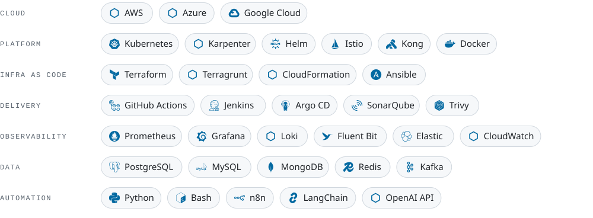

<!--
  Profile README for github.com/rajesh6752.
  Generated parts, do not edit by hand:
    assets/*.svg                → `make assets`  (scripts/render_assets.py, from profile.toml)
    "Recently active" table     → daily workflow (scripts/update_recent.py, .github/workflows/refresh.yml)
-->

<a href="https://rajeshshukla.pages.dev/">
  <picture>
    <source media="(prefers-color-scheme: dark)" srcset="https://raw.githubusercontent.com/rajesh6752/rajesh6752/main/assets/banner-dark.svg">
    
  </picture>
</a>

  <a href="https://rajeshshukla.pages.dev/"><b>Website</b></a>&nbsp;&nbsp;·&nbsp;&nbsp;<a href="https://www.linkedin.com/in/rajesh-shukla-8a8078125"><b>LinkedIn</b></a>&nbsp;&nbsp;·&nbsp;&nbsp;<a href="https://github.com/rajesh6752/karpenter-handbook"><b>Karpenter Handbook</b></a>

I build and run the platforms that product teams ship on: Kubernetes on AWS, infrastructure as code, GitOps delivery, and observability that describes what users actually experience. Hands-on since 2016 — Linux and data-centre migrations first, then cloud automation across AWS and Azure, now platform engineering and the automation around it.

**Right now**

- **Writing** the [Karpenter Handbook](https://github.com/rajesh6752/karpenter-handbook): node autoscaling on EKS from zero to advanced, with copy-paste Helm and Terraform installs, verified against Karpenter v1.15.
- **Running** Kubernetes on Spot and On-Demand capacity with Karpenter, delivered through Argo CD and Helm.
- **Treating alerting as code**: rules tied to user impact, every one linked to a runbook.
- **Automating** operational toil with n8n workflows and LLM-backed triage.

## What I build

Foundation first: each layer is only as good as the one beneath it.

| Layer | In practice |
| --- | --- |
| **Infrastructure as code** | Cloud estates you can rebuild, not remember. Reusable Terraform modules, environment segregation, drift detection, policy as code, every change reviewed. |
| **Platform engineering** | Kubernetes that teams deploy to without filing a ticket. EKS and AKS, ingress, service mesh and API gateway, Spot-aware autoscaling, guard-rails built in. |
| **Delivery** | From commit to production, with a way back. CI/CD with quality and security gates, GitOps with Argo CD, blue-green and canary where the risk justifies them. |
| **Observability** | Signals that describe what users experience. Metrics, logs and alerts wired to runbooks, so the on-call engineer knows what to do at 3 a.m. |
| **Automation & applied AI** | Agents for the operational work nobody has time for. Workflow automation, triage and summaries, Slack-first operations. |

<picture>
  <source media="(prefers-color-scheme: dark)" srcset="https://raw.githubusercontent.com/rajesh6752/rajesh6752/main/assets/toolbelt-dark.svg">
  
</picture>

## How I work

1. **Plan — measure before and after.** A deployment that is "faster" needs a number from before the change. Baselines first, then improvements you can show.
2. **Build — everything as code, including the boring parts.** If a change can only be made by clicking, it will eventually be made wrong. Infrastructure, pipelines, dashboards and alerts live in version control.
3. **Ship — fewer moving parts beat clever ones.** Every component is something to patch, monitor and explain during an incident. I add one only when its absence is the bigger risk.
4. **Operate — leave a runbook behind.** The work is not finished until someone else can run it without me.

## Featured

| Project | What it is |
| --- | --- |
| [**karpenter-handbook**](https://github.com/rajesh6752/karpenter-handbook) | 24 chapters plus a cheat sheet, FAQ and glossary: architecture, NodePools and EC2NodeClasses, disruption and Spot interruption handling, migration from Cluster Autoscaler, upgrades, security, cost and troubleshooting. Ships runnable install scripts, a Terraform configuration for existing clusters and validated NodePool recipes. |
| [**cloudgen-terraform-code**](https://github.com/rajesh6752/cloudgen-terraform-code) | AWS Terraform in a two-tier caller/definition layout (account → environment → stack), with plan-on-PR and Checkov scanning in GitHub Actions. |
| [**ElasticSearch-on-Azure-Kubernetes-with-Beats**](https://github.com/rajesh6752/ElasticSearch-on-Azure-Kubernetes-with-Beats) | ELK on Kubernetes: Elasticsearch StatefulSet, Logstash, Kibana, and Filebeat / Metricbeat / Auditbeat shippers. |
| [**multi-node-MySQL-Cluster-with-ansible**](https://github.com/rajesh6752/multi-node-MySQL-Cluster-with-ansible) | Ansible roles that build a MySQL NDB Cluster: management, data and SQL nodes. |
| [**mongodb**](https://github.com/rajesh6752/mongodb) | Replica-set install on Amazon Linux, a sharded cluster on Docker Compose, and mongosync notes. |

## Recently active

<!-- recent:start -->
| Repository | What it is | Language | Last push |
| --- | --- | --- | --- |
| [karpenter-handbook](https://github.com/rajesh6752/karpenter-handbook) | Karpenter from zero to advanced: plain-language handbook, copy-paste install (Helm/Terraform) for existing EKS clusters, and validated NodePool recipes (Spot, On-Demand, mixed) | Shell | Nov 2026 |
| [render_apps](https://github.com/rajesh6752/render_apps) | Render Blueprint for self-hosting n8n from a Docker image, with a persistent disk and health checks | Dockerfile | Aug 2026 |
| [cloudgen-terraform-code](https://github.com/rajesh6752/cloudgen-terraform-code) | AWS Terraform in a two-tier caller/definition layout (account → environment → stack) with plan-on-PR and Checkov scanning in GitHub Actions | HCL | May 2026 |
| [talent_short](https://github.com/rajesh6752/talent_short) | Multi-tenant AI hiring platform: FastAPI + SQLAlchemy/Alembic backend, Next.js front end, Docker Compose | TypeScript | Dec 2025 |
<!-- recent:end -->

---

This profile is built like any other service. The banner and toolbelt are SVGs rendered from <a href="https://github.com/rajesh6752/rajesh6752/blob/main/profile.toml"><code>profile.toml</code></a>, the table above is refreshed daily by <a href="https://github.com/rajesh6752/rajesh6752/blob/main/.github/workflows/refresh.yml">GitHub Actions</a>, and CI fails if the assets drift from their source or a link breaks.
